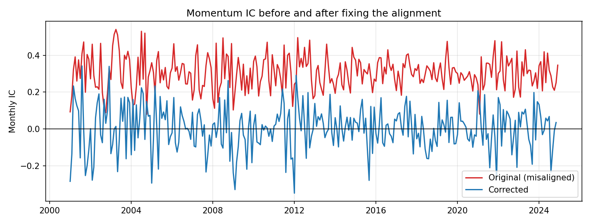
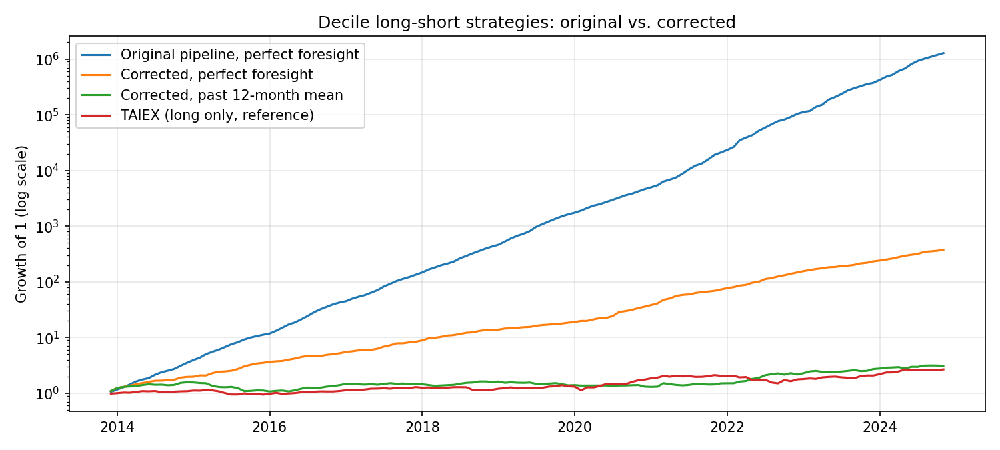
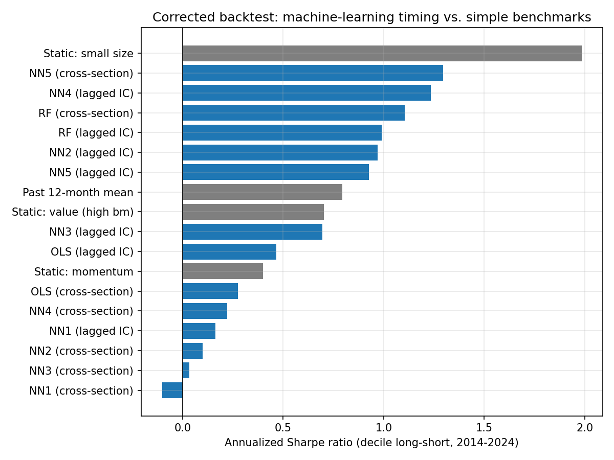

# ML Factor Timing on Taiwan Stocks

Can machine learning predict which equity factor will work next month? This project forecasts the
information coefficient (IC) of three factors (book-to-market, size, and momentum) for 1,848 Taiwan-listed
stocks with OLS, a random forest, and neural networks, then trades a long-short portfolio on the factor with
the strongest forecast.

The original course project reported annualized Sharpe ratios above 5 and machine-learning forecasts that
beat a perfect-foresight benchmark. Revisiting it, I found that those results came from a **data alignment
error**: momentum was matched with a return from inside its own calculation window. After fixing it, none of
the models forecasts the IC better than predicting zero, and **always holding the small-size factor (Sharpe
1.98) outperforms every machine-learning timing strategy (best 1.41)**.



## The Error

The IC of a factor at month *t* is the cross-sectional correlation between the factor and each stock's return
from *t* to *t*+1. Momentum is the past return from *t*−12 to *t*−1, so its sheet started 12 months later than
the return sheet. The two sheets were matched by column position, which paired momentum at *t* with the
return from *t*−12 to *t*−11. That return is part of the momentum calculation itself, so the correlation was
mechanically positive.

| | Mean momentum IC | Months with IC > 0 |
|---|---|---|
| Original (misaligned) | 0.304 | 100% |
| Corrected | 0.002 | 51% |

Because momentum always had the largest IC, the models chose it almost every month. Reproducing the original
pipeline in Python confirms the original results: the random forest and NN5 choose momentum in all 132 test
months, with annual returns above 100% and Sharpe ratios of 7 to 10.5. The reproduction uses the same code as
the corrected analysis, with only the momentum alignment and median filling switched back to the original
logic, so the difference can be attributed to these two steps.



## Method

- **Data**: monthly TEJ data for 1,848 Taiwan-listed common stocks, January 2000 to December 2024.
- **Factors**: book-to-market (1 / P/B), size (log market cap), and momentum (log return from *t*−12 to *t*−1).
- **IC forecasts**: every month, each model is refitted using only information available at that time and
  predicts next month's IC for each factor. Test period: December 2013 to November 2024 (132 months).
- **Models**: OLS, random forest (depth 3), and neural networks NN1 to NN5 with 1 to 5 hidden layers
  (32, 16, 8, 4, 2 units), following the architectures of Gu, Kelly, and Xiu (2020).
- **Features**: the original design (factor values of all 1,848 stocks in the previous month) and an
  alternative using the 12 most recent ICs of all three factors.
- **Strategy**: choose the factor with the largest absolute predicted IC; buy the top decile and short the
  bottom decile (reversed if the IC is negative); hold one month.

### What changed from the original

**Error fixes**

| | Original | Corrected |
|---|---|---|
| Momentum alignment | Paired with the return 12 months earlier | Paired with the next month's return |
| Neural network training | One model kept training across months and factors | A new model for every factor and month |

**Methodology**

| | Original | Corrected |
|---|---|---|
| Missing values | Factor and return filled with the monthly median | Stocks without data that month are excluded |
| Stocks per group | Based on all 1,848 stocks | Based on the stocks with data that month |
| Portfolio return | Average log return | Average simple return |
| Test period | 133 months, to December 2024 | 132 months, to November 2024 (December has no next-month return) |
| Performance | Win rate against the TAIEX, monthly Sharpe | Annualized Sharpe, t-statistic, max drawdown |
| Benchmarks | Perfect foresight, TAIEX | Also past-IC average and static single-factor strategies |

**Implementation**

| | Original | Corrected |
|---|---|---|
| Calculations | Excel formulas and notebooks | One Python pipeline |
| Neural networks | Keras, L1 regularization, raw inputs | scikit-learn `MLPRegressor`, L2 regularization, standardized inputs |
| Random forest refits (cross-section features) | Monthly | Yearly, to keep the running time reasonable |

The neural networks reproduce the original architectures but are not identical to the Keras models, so their
results will differ somewhat.

## Results

### Forecast accuracy

Out-of-sample R² against a forecast of zero:

| Model | Cross-section features | Lagged-IC features |
|---|---|---|
| OLS | −2.28 | −0.21 |
| Random forest | 0.05 | 0.04 |
| NN1 | −78.7 | −3.37 |
| NN2 | −45.8 | −0.10 |
| NN3 | −34.1 | −1.54 |
| NN4 | −8.61 | −0.62 |
| NN5 | −0.72 | −0.02 |

Only the shallow random forest is slightly positive, because it stays close to the average IC. With 1,848
features and only 160 to 300 monthly training observations, the neural networks overfit badly.

### Backtest (decile long-short, December 2013 to November 2024)

| Strategy | Annual return | Sharpe | t-stat | Max drawdown |
|---|---|---|---|---|
| Perfect foresight (upper bound) | 55.7% | 5.24 | 17.4 | −1.1% |
| **Static: small size** | **26.1%** | **1.98** | **6.58** | **−8.3%** |
| NN5, cross-section | 15.6% | 1.41 | 4.69 | −8.9% |
| NN4, lagged IC | 15.5% | 1.24 | 4.10 | −12.3% |
| Random forest, cross-section | 15.5% | 1.19 | 3.94 | −12.2% |
| Past 12-month mean IC | 11.3% | 0.79 | 2.63 | −31.7% |
| Static: value (high bm) | 8.8% | 0.70 | 2.33 | −19.3% |
| OLS, cross-section | 3.5% | 0.28 | 0.91 | −29.2% |
| NN1 to NN4, cross-section | −1.4% to 3.3% | −0.10 to 0.22 | < 1 | −30% to −53% |



The better models mostly choose size or book-to-market, so their returns largely reflect exposure to those
factors rather than successful timing. The full results, including all 14 group counts used in the original
project, are in [`analysis.ipynb`](analysis.ipynb) and [`results/`](results/).

## Limitations

- **Survivorship bias.** The sample includes only companies still listed in December 2024. Firms that delisted
  during the test period are missing, which likely inflates the small-size results in particular. Fixing this
  requires delisted-company data from TEJ.
- **No transaction costs.** Monthly rebalancing of long-short portfolios would incur substantial costs.
- **Three factors, one market.** Results may differ with more factors or other markets.
- **Multiple comparisons.** Fourteen model and feature combinations were tested, so the best of them is likely
  to look better than it would on new data.

## Repository Structure

```
ml-ic-factor-portfolio/
├── analysis.ipynb        # Full analysis: the error, forecasts, backtests
├── src/
│   ├── prepare_data.py   # Converts the TEJ Excel exports to CSV
│   ├── factors.py        # Returns and factors, plus a reproduction of the original logic
│   ├── ic.py             # Monthly IC
│   ├── models.py         # Walk-forward IC forecasts and out-of-sample R²
│   └── backtest.py       # Long-short backtest and performance measures
├── figures/              # Figures used in this README
├── results/              # Aggregated results as CSV (no stock-level data)
├── original/             # Original course notebooks (Keras and scikit-learn)
├── data/                 # TEJ data (not included)
└── requirements.txt
```

### Results files

| File | Content |
|---|---|
| `ic_true.csv` | Monthly IC of each factor, corrected and original |
| `ic_predicted.csv` | Predicted IC for every model and feature set |
| `chosen_factor.csv` | Factor chosen by each strategy each month |
| `strategy_returns.csv` | Monthly decile long-short return of each strategy |
| `performance.csv` | Performance summary of all strategies |
| `sharpe_by_group_count.csv` | Sharpe ratio for all 14 group counts |
| `oos_r2.csv` | Out-of-sample R² |
| `original_reproduction.csv` | Results of the original pipeline reproduced in Python |

Months are labelled by when the portfolio is formed: `2013/12` is held from the end of December 2013 to the
end of January 2014.

## How to Run

1. Install dependencies (Python 3.9 or later):

   ```bash
   python3 -m venv .venv
   source .venv/bin/activate
   pip install -r requirements.txt
   ```

2. Place the TEJ exports in `data/` (not included because the data is licensed):

   | File | Sheet | Content |
   |---|---|---|
   | `price.xlsx` | 收盤價 | Monthly closing prices |
   | `size.xlsx` | 市值 | Market capitalization |
   | `bm.xlsx` | 股價淨值比 | Price-to-book ratio |
   | `Real.xlsx` | first sheet, row `TWII` | TAIEX monthly log returns (used only as a reference line) |

   Each sheet has stock code and name in the first two columns and one column per month (`YYYY/MM`).

3. Convert to CSV, then run the notebook:

   ```bash
   python -m src.prepare_data
   ```

   The first run of `analysis.ipynb` takes about 15 to 30 minutes; forecasts are cached in `cache/`.

## Project History

This started as the final project for *FinTech Innovation and Applications* at Soochow University (Spring 2025).
The original notebooks are in [`original/`](original/): the factor and IC calculations were done in Excel, and
the IC forecasts and backtests in Python. In 2026 I revisited the project, found the momentum alignment error,
and rebuilt the full pipeline in Python with corrected alignment, walk-forward forecasts, and additional
benchmarks.

## Reference

Gu, S., Kelly, B., & Xiu, D. (2020). Empirical asset pricing via machine learning. *The Review of Financial
Studies*, 33(5), 2223–2273.
